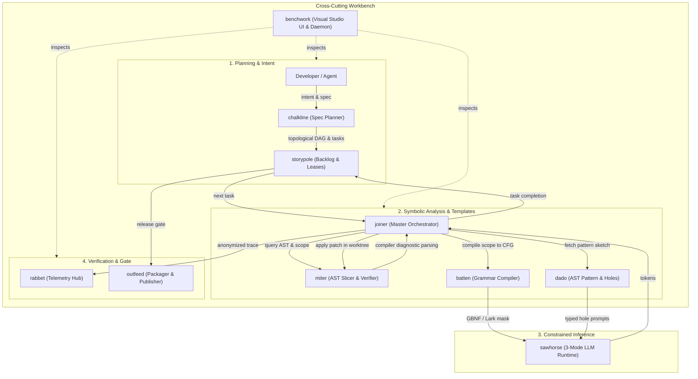

# System Architecture — `gaugeblock` Meta-Harness

> **Meta-Harness:** `gaugeblock` (`neurosymbolic-suite`)  
> **Topology:** 10 Autonomous Repositories + Shared Data Contracts  
> **Lifecycle:** `0.1.0-beta.X`

---

## 1. High-Level Ecosystem Topology

The `gaugeblock` meta-harness wrings together 10 independent repositories into an end-to-end neurosymbolic code synthesis loop. Every repository functions as a standalone CLI, library crate, and MCP server, while adhering to shared wire protocols defined in `CONTRACTS.md`.



---

## 2. Repository & Workspace Topology

The meta-harness organizes 10 standalone Git checkouts mapped via local `.cargo/config.toml` `[patch.crates-io]` for zero-friction local multi-repo development:

```text
neurosymbolic-suite/               # Root meta-harness & contract coordinator
├── .gaugeblock/                   # Shared config, Storypole ledger, docs policies
│   ├── config.toml                # Multi-tool unified configuration
│   ├── docs.toml                  # 9-Document architecture policies
│   └── storypole/                 # Append-only task and claim ledger
├── CONTRACTS.md                   # Formal shared wire types and schemas
├── miter/                         # AST slicing, scope indexing, redb engine
├── storypole/                     # Git-native SQLite/JSONL backlog & claim leases
├── sawhorse/                      # 3-Mode provider-agnostic LLM runtime
├── chalkline/                     # Spec planner, /grill-me, 9-doc manager
├── dado/                          # AST pattern templates & typed holes
├── batten/                        # Scope-to-grammar compiler & token masks
├── joiner/                        # Neurosymbolic synthesizer & repair loop
├── benchwork/                     # Multi-repo web CAD console & daemon
├── rabbet/                        # Telemetry corpus hub & training foundry
└── outfeed/                       # Release gate, SemVer bump, packager
```

---

## 3. Crate & Package Topology


### `batten`
- Path: `batten/`
- Version: `0.1.0-beta.2`
- Description: Dynamic variable-scope to Context-Free Grammar (GBNF/Lark) compiler and token mask generator

### `batten-cli`
- Path: `batten/crates/batten-cli`
- Version: `0.1.0-beta.2`
- Description: Command-line interface and MCP server for batten

### `batten-core`
- Path: `batten/crates/batten-core`
- Version: `0.1.0-beta.2`
- Description: Core library, type normalizer, scope filter, and CFG emitters for batten

### `batten-mcp`
- Path: `batten/crates/batten-mcp`
- Version: `0.1.0-beta.2`
- Description: Model Context Protocol server for batten grammar compiler

### `benchwork`
- Path: `benchwork/`
- Version: `0.1.0-beta.4`
- Description: Modular visual workbench UI and local daemon for neurosymbolic code synthesis and DAG inspection

### `benchwork-cli`
- Path: `benchwork/crates/benchwork-cli`
- Version: `0.1.0-beta.4`
- Description: Command-line interface and local daemon for benchwork

### `benchwork-core`
- Path: `benchwork/crates/benchwork-core`
- Version: `0.1.0-beta.4`
- Description: Core domain types, workspace aggregation, and multi-crate services for benchwork

### `benchwork-mcp`
- Path: `benchwork/crates/benchwork-mcp`
- Version: `0.1.0-beta.4`
- Description: Model Context Protocol stdio server for benchwork

### `chalkline`
- Path: `chalkline/`
- Version: `0.1.0-beta.2`
- Description: Interactive specification planner, ambiguity resolver, and topological task DAG compiler.

### `chalkline-cli`
- Path: `chalkline/crates/chalkline-cli`
- Version: `0.1.0-beta.2`
- Description: Command-line interface and entrypoint for chalkline

### `chalkline-core`
- Path: `chalkline/crates/chalkline-core`
- Version: `0.1.0-beta.2`
- Description: Core library, spec parser, recon engine, ambiguity griller, and DAG compiler for chalkline

### `chalkline-mcp`
- Path: `chalkline/crates/chalkline-mcp`
- Version: `0.1.0-beta.2`
- Description: Model Context Protocol (MCP) stdio server for chalkline

### `dado`
- Path: `dado/`
- Version: `0.1.0-beta.2`
- Description: Deterministic polyglot AST pattern & typed hole engine

### `dado-cli`
- Path: `dado/crates/dado-cli`
- Version: `0.1.0-beta.2`
- Description: CLI binary and entrypoints for dado

### `dado-core`
- Path: `dado/crates/dado-core`
- Version: `0.1.0-beta.2`
- Description: Core library, AST pattern engine, typed hole parser, and polyglot codegen for dado

### `dado-mcp`
- Path: `dado/crates/dado-mcp`
- Version: `0.1.0-beta.2`
- Description: Model Context Protocol (MCP) server for dado

### `joiner`
- Path: `joiner/`
- Version: `0.1.0-beta.2`
- Description: Master neurosymbolic synthesis orchestrator for the gaugeblock suite

### `joiner-cli`
- Path: `joiner/crates/joiner-cli`
- Version: `0.1.0-beta.2`
- Description: Command-line interface and daemon for joiner

### `joiner-core`
- Path: `joiner/crates/joiner-core`
- Version: `0.1.0-beta.2`
- Description: Core orchestration loop, System 1 router, hole filler, and verifier for joiner

### `joiner-mcp`
- Path: `joiner/crates/joiner-mcp`
- Version: `0.1.0-beta.2`
- Description: Model Context Protocol (MCP) server for joiner

### `miter-ast`
- Path: `miter/crates/ast_indexer`
- Version: `0.1.0-beta.1`
- Description: Tree-sitter AST ingestion: functions, inputs and return types with their provenance and nesting depth

### `miter-cli`
- Path: `miter/`
- Version: `0.1.0-beta.1`
- Description: Workspace member crate

### `miter-engine`
- Path: `miter/crates/engine`
- Version: `0.1.0-beta.1`
- Description: AST storage and analysis engine: polyglot model, hydration, audit, slices, clones, contracts and secret redaction

### `miter-harness`
- Path: `miter/crates/harness`
- Version: `0.1.0-beta.1`
- Description: Deterministic compiler verification: sandboxed git worktrees and diagnostic parsing for `miter verify`

### `miter-mcp`
- Path: `miter/crates/mcp`
- Version: `0.1.0-beta.1`
- Description: Model Context Protocol (MCP) stdio server exposing AST hydration and compiler verification

### `miter-storage`
- Path: `miter/crates/storage`
- Version: `0.1.0-beta.1`
- Description: Canonical redb tables, schema versioning and auto-purge recovery for the miter workspace database

### `outfeed`
- Path: `outfeed/`
- Version: `0.1.0-beta.2`
- Description: Neurosymbolic release gate, AST drift inspector, changelog synthesizer, and delivery orchestrator

### `outfeed-cli`
- Path: `outfeed/crates/outfeed-cli`
- Version: `0.1.0-beta.2`
- Description: Command-line interface and entrypoints for outfeed release and packaging

### `outfeed-core`
- Path: `outfeed/crates/outfeed-core`
- Version: `0.1.0-beta.2`
- Description: Core release planner, SemVer bump calculator, topological DAG resolver, and Keep a Changelog synthesizer

### `outfeed-mcp`
- Path: `outfeed/crates/outfeed-mcp`
- Version: `0.1.0-beta.2`
- Description: Model Context Protocol (MCP) stdio server for outfeed release management

### `rabbet`
- Path: `rabbet/`
- Version: `0.1.0-beta.2`
- Description: AST-anonymized telemetry corpus hub and open-weight micro-model training foundry

### `rabbet-cli`
- Path: `rabbet/crates/rabbet-cli`
- Version: `0.1.0-beta.2`
- Description: Command-line interface, ingestion daemon, and maintainer admin console for rabbet

### `rabbet-core`
- Path: `rabbet/crates/rabbet-core`
- Version: `0.1.0-beta.2`
- Description: Core domain types, SQLite master store, Parquet exporter, and miners for rabbet

### `sawhorse`
- Path: `sawhorse/`
- Version: `0.1.0-beta.3`
- Description: Provider-agnostic 3-mode LLM runtime for deterministic neurosymbolic code synthesis.

### `sawhorse-cli`
- Path: `sawhorse/crates/sawhorse-cli`
- Version: `0.1.0-beta.3`
- Description: Command-line interface and diagnostic tooling for sawhorse

### `sawhorse-core`
- Path: `sawhorse/crates/sawhorse-core`
- Version: `0.1.0-beta.3`
- Description: Core library, contracts, routing, and provider adapters for sawhorse

### `storypole`
- Path: `storypole/`
- Version: `0.1.0-beta.2`
- Description: Git-native SQLite and JSONL backlog, task DAG, and MCP memory store for AI coding agents.

### `storypole-cli`
- Path: `storypole/crates/storypole-cli`
- Version: `0.1.0-beta.2`
- Description: Command-line interface and entrypoint for storypole

### `storypole-core`
- Path: `storypole/crates/storypole-core`
- Version: `0.1.0-beta.2`
- Description: Core library, models, ledger, and DAG engine for storypole

### `storypole-mcp`
- Path: `storypole/crates/storypole-mcp`
- Version: `0.1.0-beta.2`
- Description: Model Context Protocol (MCP) stdio server for storypole

