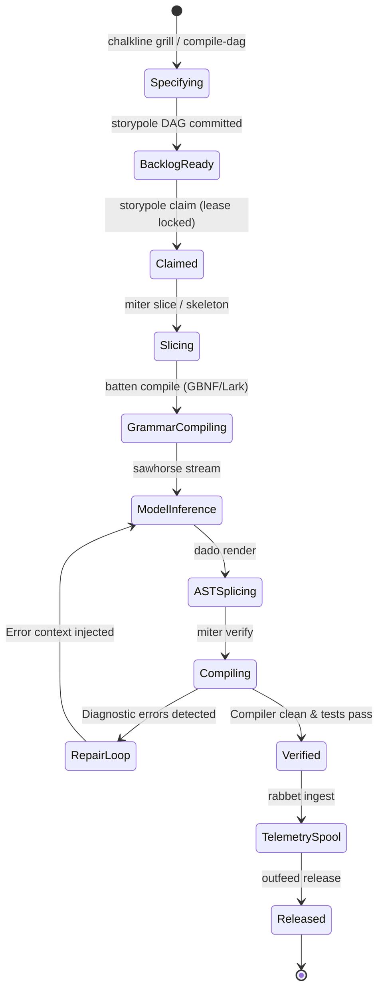

# `gaugeblock` — Meta-Harness Behavioral Specifications & Invariants

> **Suite Behavioral Invariants, Neurosymbolic State Machines, Wire Contracts & Quality Invariants**

Part of the **[`gaugeblock`](https://gaugeblock.dev)** precision neurosymbolic code synthesis ecosystem.

---

## 1. Non-Negotiable System Invariants

Every tool and process across the `gaugeblock` meta-harness adheres to these core behavioral laws:

1. **Deterministic AST Grounding:** Symbol IDs, AST slices, and lexical scopes are content-addressed and pure functions of the filesystem tree. Given the same source code, `miter`, `chalkline`, `dado`, and `batten` produce identical byte outputs on every machine.
2. **Git-Native Event Sourcing:** Backlog state (`storypole`) is persisted in Git-tracked, append-only JSON Lines ledgers (`.gaugeblock/storypole/ledger.jsonl`). Relational queries run against an ephemeral SQLite cache derived deterministically from the ledger.
3. **Branch Isolation & Lease Semantics:** Multi-agent workflows require task claims with explicit lease expirations (`AgentClaim`). Work is developed on isolated feature branches (`feat/...`) and verified before integration.
4. **Pure Markdown Invariance:** Documentation engines (`chalkline docs sync`, `chalkline docs check`) MUST NOT inject or rely upon non-standard HTML comment markers. Section targeting is achieved strictly via native Markdown AST heading ranges (`pulldown-cmark`).
5. **Zero-Panic Library Boundary:** Library crates (`*-core`, `*-engine`) MUST use `thiserror` with strongly typed domain errors. `.unwrap()` and `.expect()` are forbidden in production library paths (enforced at compile time via `clippy::unwrap_used = "deny"`).
6. **Hard 250-Line File Limit:** No `.rs`, `.ts`, or `.tsx` source file may exceed 250 lines of code. Modular submodules and sibling test directories are strictly enforced.

---

## 2. End-to-End Neurosymbolic Synthesis State Machine

The master synthesis loop coordinates the entire suite:

* **System 1 (Fast Deterministic AST Splicing):** If a target hole matches an existing verified AST pattern in `dado`, it is rendered directly without calling an LLM.
* **System 2 (Constrained Model Synthesis):** When novel code is required, `batten` compiles active variable scopes into CFG grammars (GBNF/Lark/Regex), forcing `sawhorse` to generate syntactically valid code matching in-scope variables.
* **Compiler Repair Loop:** If `miter verify` detects compiler diagnostics (`rustc` / `tsc`), the errors are structured and fed back into `joiner` for targeted, iterative hole repair.

---

## 3. Suite Wire Contracts & Boundary Types

The following core boundary and wire contracts govern cross-repository interactions across the 10 member repositories (per `CONTRACTS.md`):

| Type | Kind | Scope | Role & Contract Responsibility |
|---|---|---|---|
| `LexicalScope` | `struct` | `miter-engine` | Extracted variable bindings and imports at an AST hole boundary. |
| `SymbolBinding` | `struct` | `miter-engine` | Bound identifier name, inferred type, mutability, and symbol kind. |
| `VerificationReport` | `struct` | `miter-engine` | Verification result containing AST validity, typecheck pass, and diagnostics. |
| `CompilerDiagnostic` | `struct` | `miter-engine` | Parsed compiler error diagnostic (file, line, column, error code, message). |
| `StorypoleConfig` | `struct` | `storypole-core` | Backlog configuration, prefix, claim TTL, and verification commands. |
| `TaskPlan` | `struct` | `storypole-core` | Structured multi-step task execution plan attached to a ticket. |
| `AgentClaim` | `struct` | `storypole-core` | Active agent lease lock with timeout epoch and assigned branch. |
| `VerificationReceipt` | `struct` | `storypole-core` | Cryptographic/commit receipt certifying task completion. |
| `DecisionHole` | `struct` | `chalkline-core` | Extracted architectural decision fork with evaluated trade-offs. |
| `DecisionOption` | `struct` | `chalkline-core` | Proposed option for a decision fork with impacted symbols. |
| `SharedTypeContract` | `struct` | `chalkline-core` | Language-neutral wire contract model consumed by `dado` for codegen. |
| `ContractField` | `struct` | `chalkline-core` | Typed field in a shared wire contract schema. |
| `CompilationReceipt` | `struct` | `chalkline-core` | Receipt certifying successful compilation of spec tasks into Storypole. |
| `SpecDoc` | `struct` | `chalkline-core` | Parsed markdown specification document AST. |
| `SpecTask` | `struct` | `chalkline-core` | Specification task item with dependency edges. |
| `ReconReport` | `struct` | `chalkline-core` | Detected codebase conventions, testing frameworks, and runtimes. |
| `DocAuditReport` | `struct` | `chalkline-core` | Single-repository 9-document architecture compliance report. |
| `WorkspaceDocsAuditReport` | `struct` | `chalkline-core` | Aggregated multi-repository workspace documentation compliance matrix. |
| `DocStatus` | `enum` | `chalkline_core` | Document status: `Present`, `Missing`, `Drifted`. |
| `SawhorseConfig` | `struct` | `sawhorse-core` | Multi-provider runtime configuration loaded from `.gaugeblock/config.toml`. |
| `RoleConfig` | `struct` | `sawhorse-core` | Model mapping per synthesis role (Planner, Synthesizer, Repairer). |
| `TimeoutConfig` | `struct` | `sawhorse-core` | HTTP connection and generation timeouts per provider. |
| `TypedHole` | `struct` | `dado-core` | AST hole expression with expected type and syntactic constraints. |
| `DadoPattern` | `struct` | `dado-core` | Polyglot AST pattern with typed holes and required imports. |
| `SpliceResult` | `struct` | `dado-core` | Synthesized code with replaced typed holes. |
| `ValidationReport` | `struct` | `batten-core` | Grammar validation report evaluating candidate code against CFG rules. |
| `SynthesisResult` | `struct` | `joiner-core` | Master result of a neurosymbolic synthesis run with patch diffs. |
| `AnonymizedSynthesisTrace` | `struct` | `rabbet-core` | Privacy-scrubbed telemetry trace for open-weight model training. |
| `ReleasePlan` | `struct` | `outfeed-core` | Single-repository release plan with SemVer bump and changelog entries. |
| `SuiteReleasePlan` | `struct` | `outfeed-core` | Orchestrated multi-repository release plan and lockfile updates. |

---

## 4. Meta-Harness Tool Taxonomy

| Tool | Binary | Role & Responsibility |
|---|---|---|
| `miter` | `miter` | Polyglot AST indexer, lexical scope analyzer, and compiler error verifier. |
| `storypole` | `storypole` | Git-native append-only backlog, task DAG, and agent continuity memory. |
| `sawhorse` | `sawhorse` | 3-mode LLM inference runtime (OpenAI-compat, local GGUF, Candle). |
| `chalkline` | `chalkline` | Spec planner, ambiguity griller, DAG compiler, and 9-doc architecture manager. |
| `dado` | `dado` | Polyglot AST pattern engine, typed hole extractor, and Tree-sitter splicer. |
| `batten` | `batten` | Dynamic scope-to-CFG grammar compiler and pre-flight token mask validator. |
| `joiner` | `joiner` | Master neurosymbolic hole filler, System 1/2 router, and compiler repair loop. |
| `benchwork` | `benchwork` | Local CAD console web UI, multi-repo aggregator, and Benji AI engineer. |
| `rabbet` | `rabbet` | Telemetry corpus hub, privacy scrubber, and open-weight training foundry. |
| `outfeed` | `outfeed` | Neurosymbolic release gate, AST drift inspector, and packaging orchestrator. |
